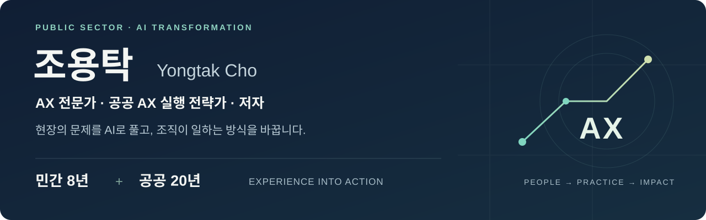

# 조용탁 · Yongtak Cho

**공공 AX 실행 전략가 | AI·데이터 기반 행정 전문가 | 저자**

[LinkedIn](https://www.linkedin.com/in/yongtak-cho/) · [조용탁의 공공 AX](https://okmentor.tistory.com/) · [저자 소개](https://www.yes24.com/product/goods/168228373)

> 현장의 문제를 AI로 풀고, 조직이 일하는 방식을 바꿉니다.

민간에서 8년, 공공에서 20년. 두 현장에서 쌓은 경험을 바탕으로 **AI 전환(AX)을 조직의 실행력으로 연결하는 일**을 합니다. 기업 현장의 문제 해결 경험에 공공의 정책·업무 이해를 더해, 공무원과 조직이 AI를 실제 업무에 활용하도록 돕습니다.

현재 **한국지능정보사회진흥원(NIA) 수석**으로 일하며 공공 AX 전략, 데이터기반행정, AI 챔피언과 거점 리더 육성에 집중하고 있습니다. 현장에서 얻은 경험을 책과 글로 정리하고, 업무에 적용할 방법을 연구합니다.

<table>
  <tr>
    <td align="center" width="33%"><strong>8년</strong> 민간 경력 컨설팅 · 기업 정보화</td>
    <td align="center" width="33%"><strong>20년</strong> 공공 경력 디지털 정부 · AI·데이터 행정</td>
    <td align="center" width="33%"><strong>2권</strong> 저서 · 공저 AI 거점 리더 · 관리자의 품격</td>
  </tr>
</table>

## 집중하는 일

| 분야 | 다루는 과제 |
| :--- | :--- |
| **공공 AX 전략과 실행** | 기관의 업무에서 AI 적용 과제를 찾고, 실행 계획과 성과 확인 방법을 설계합니다. |
| **AI 챔피언·거점 리더 육성** | 현업의 문제를 정의하고 동료와 함께 해결하는 사람을 키웁니다. |
| **데이터기반행정** | 데이터를 해석해 정책과 업무의 판단 근거로 쓰는 방법을 다룹니다. |
| **AI 리더십과 조직 변화** | 관리자의 역할, 구성원의 학습과 협업, AI 윤리와 책임 있는 활용을 연구합니다. |

## 현장에서 쌓은 경험

**에이시에스 컨설턴트 → 기업정보화지원센터 팀장 → 한국지능정보사회진흥원 수석**

전자정부 해외 진출, 국가정보화전략, 공공 클라우드 등 디지털 전환 과제를 거쳐 공공부문의 AI 활용과 조직 역량을 높이는 일을 이어오고 있습니다.

- **방법론 개발** — AI 챔피언 역량인증 체계, 공공부문 AI 윤리원칙, 공공부문 AI 전환 전략
- **주요 표창** — 국무총리 표창, 행정안전부 장관 표창

주요 경력·표창: <a href="https://www.yes24.com/product/goods/168228373">『AI 거점 리더』 저자 소개</a>

## 책으로 전하는 경험

### 『AI 거점 리더』

**조용탁 지음 · 플랜비디자인 · 2025**

AI를 현업에 연결하는 리더를 위한 실무서입니다. 소통, 문제 정의, 학습, 실행을 중심으로 조직 안에서 변화를 시작하고 확산하는 방법을 다룹니다.

[책 살펴보기 →](https://www.yes24.com/product/goods/168228373)

### 『AI 시대, 관리자의 품격』

**조용탁 외 AI 거점리더 12인 공저 · 경성문화사 · 2026**

공공 현장의 AX 경험을 바탕으로 AI 시대 관리자의 판단과 역할을 살핍니다. 리더십부터 실행, 기술 선택, 업무 활용까지 현장의 고민을 담았습니다.

[전자책 보기 →](https://www.yes24.com/product/goods/192563932) · [NIA 발간 안내·PDF →](https://www.nia.or.kr/site/nia_kor/ex/bbs/View.do?bcIdx=29603&cbIdx=99835)

## 쓰고, 나누고, 실험합니다

**[조용탁의 공공 AX](https://okmentor.tistory.com/)** 에 공공 AX 전략과 현장 사례, AI 챔피언의 역할, 관리자 리더십에 관한 글을 씁니다. **[LinkedIn](https://www.linkedin.com/in/yongtak-cho/)** 에서는 AI와 조직 변화에 관한 생각을 나눕니다.

GitHub에서는 이러한 경험을 바탕으로 AI 업무 도구와 적용 방법을 실험하고자 합니다. 실제 업무에서 쓸모가 있는지 살피며, 다른 사람도 활용할 수 있는 형태로 정리하는 것이 목표입니다.

---

### About me

I am **Yongtak Cho**, an AI transformation strategist and author with **8 years in the private sector and 20 years in the public sector**. My work at the **National Information Society Agency (NIA), Korea** focuses on public-sector AI adoption, data-informed administration, and developing the people who lead organizational change.

I write about practical AI leadership and explore how AI can improve everyday work in government.

**[Connect on LinkedIn](https://www.linkedin.com/in/yongtak-cho/)**
